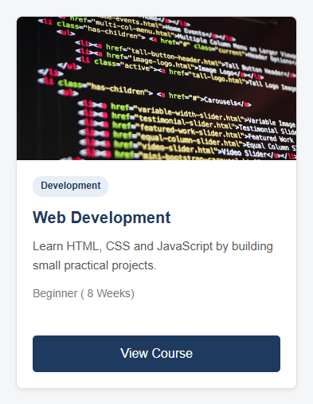
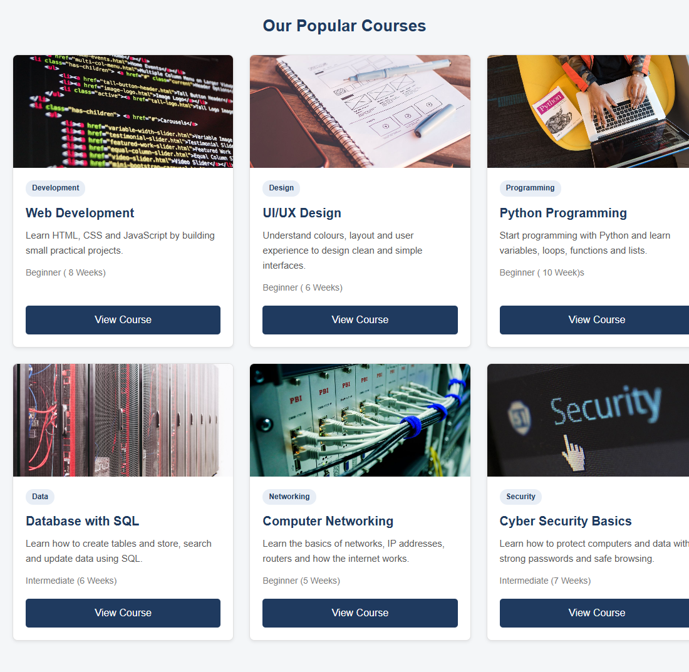
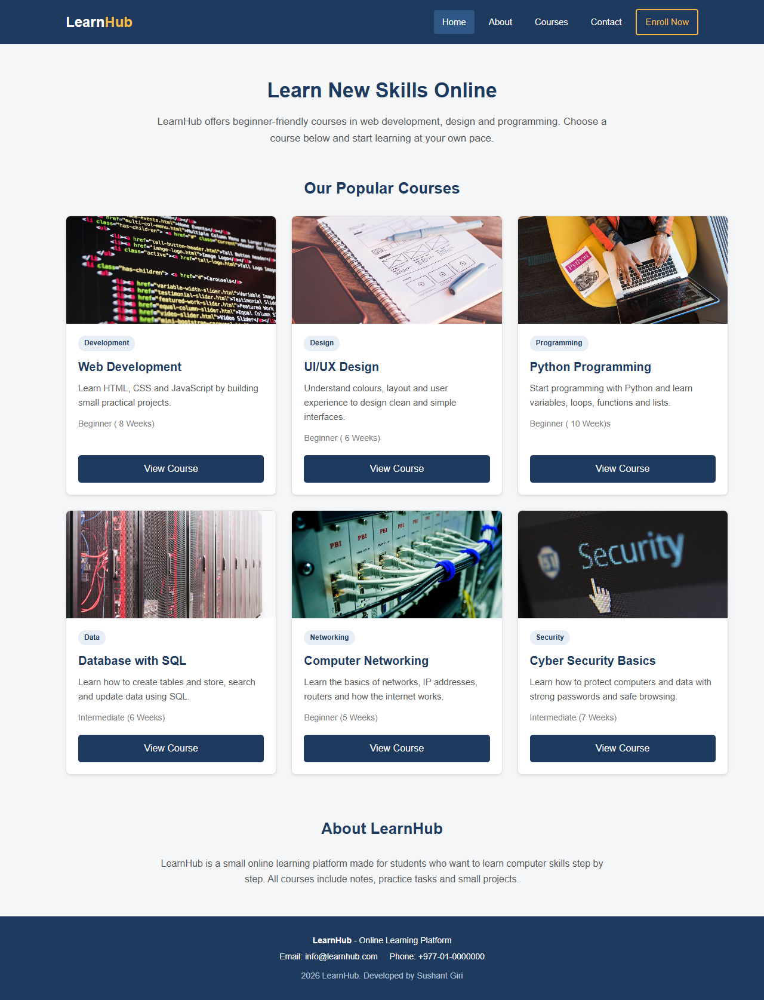

# HTML & CSS — Navigation Bar and Card Design

## Student Information

| Detail | Information |
|
| **Name** | Sushant Giri |
| **Student ID** |  2602412382 |
| **Course/Module** | Fundamentals of Software Engineering |
| **Level** | L1 |
| **Assignment Title** | Building a Navigation Bar and Responsive Card Layout Using HTML & CSS |

---

## Project Description

For this assignment I made a small one-page website called **LearnHub**. It is a simple online course website.

The page has:

- A **header** with a navigation bar (logo text, Home, About, Courses, Contact and an extra "Enroll Now" button)
- A **main section** with a heading and a short introduction
- A **course card section** with **6 cards**. Each card has an image, a category tag, a title, a short description, extra information (level and duration) and a "View Course" button
- A short **About** section
- A **footer** with contact information

The cards show **3 per row on desktop**, **2 per row on tablet** and **1 per row on mobile**. I used CSS Grid for the card layout and Flexbox for the navigation bar and the inside of each card. I did not use any JavaScript because this assignment is about HTML and CSS.

---

## Project Structure

```text
html-css-assignment/
│
├── index.html
├── css/
│   └── style.css
│
├── images/
│   ├── web-development.png
│   ├── ui-design.png
│   ├── python.png
│   ├── database.png
│   ├── networking.png
│   └── cyber-security.png
│
├── screenshots/
│   ├── navigation-bar.png
│   ├── card-design.png
│   ├── card-layout.png
│   ├── full-page-desktop.png
│   ├── tablet-layout.png
│   └── mobile-layout.png
│
└── README.md
```

---

## Technologies Used

- HTML5 (semantic elements)
- CSS3
- CSS Flexbox
- CSS Grid
- Responsive CSS (media queries)

---

## Learning Resources

| No. | Resource | Topic Learned | What I Learned | How I Applied It |
|---|---|---|---|---|
| 1 | Teacher's lecture/material | CSS Selectors | I learned the difference between element selectors, class selectors and descendant selectors, and that class selectors are better when I want to style the same thing many times. | I gave all cards the same classes (`.card`, `.card-title`, `.card-text`) so one CSS rule styles all 6 cards. I used a descendant selector `.nav-links a` to style only the links inside the navigation list. |
| 2 | University learning material | HTML Structure | I learned that semantic elements like `<header>`, `<nav>`, `<main>`, `<section>`, `<article>` and `<footer>` describe the meaning of the content, which helps screen readers and makes code easier to read than using only `<div>`. | I used `<header>` and `<nav>` for the navigation bar, `<main>` for the main content, `<section>` for each part of the page, `<article>` for each card and `<footer>` at the bottom. |
| 3 | Class demonstration | Box Model | I learned that every element is a box made of content, padding, border and margin, and that `box-sizing: border-box` makes the width include padding and border. | I added `box-sizing: border-box` at the start of my CSS and used padding and margin to space out the navbar links, card content and sections. |
| 4 | MDN Web Docs — *Basic concepts of flexbox* | Flexbox | I learned how `display: flex` puts items in a row, how `justify-content: space-between` pushes items to opposite sides, and how `align-items: center` centres them vertically. I also learned that `flex-direction: column` stacks items. | I used Flexbox on `.navbar` to put the logo on the left and links on the right, and on `.nav-links` to put the links in one row with `gap`. On mobile I changed the navbar to `flex-direction: column`. |
| 5 | MDN Web Docs — *Basic concepts of grid layout* and *CSS layout cookbook: Card* | CSS Grid and card layout | I learned how `grid-template-columns: 33.33% 33.33% 33.33%` makes three equal columns and how `gap` adds space between rows and columns. From the card example I learned that making the card a flex column lets the button stay at the bottom. | I used Grid for `.card-container`. Inside each card I used `display: flex; flex-direction: column` and `margin-top: auto` on the button so all buttons line up. |
| 6 | MDN Web Docs — *Using media queries* | Responsive design | I learned how `@media (max-width: ...)` applies CSS only when the screen is smaller than a certain width, and that the `viewport` meta tag is needed for mobile phones. | I added two media queries: at 900px the grid changes to 2 columns, and at 600px it changes to 1 column and the navbar stacks. I added the viewport meta tag in the `<head>`. |
| 7 | MDN Web Docs — *object-fit* | Image handling | I learned that `object-fit: cover` makes an image fill its box without stretching it, by cutting off the extra part. | I gave every card image `width: 100%`, `height: 180px` and `object-fit: cover` so all images are the same size. |
| 8 | W3Schools — *CSS Navigation Bar* and *CSS Transitions* | Hover effects | I learned how to use the `:hover` pseudo-class to change the style when the mouse is on a link, and how `transition` makes the change smooth instead of sudden. | I added a background colour on `.nav-links a:hover`, changed the button colour on `.card-button:hover`, and used `transform: translateY(-5px)` with a bigger shadow on `.card:hover`. |


## Image Credits

The six course images in the `images/` folder are free stock photos that I researched and downloaded from Pexels.

| File in `images/` | Card | Photo title | Photographer | Source URL |
|---|---|---|---|---|
| `web-development.png` | Web Development | Html Code | Pixabay | https://www.pexels.com/photo/html-code-270366/ |
| `ui-design.png` | UI/UX Design | Notebook Beside the iPhone on Table | picjumbo.com | https://www.pexels.com/photo/notebook-beside-the-iphone-on-table-196644/ |
| `python.png` | Python Programming | Woman Programming on a Notebook | Christina Morillo | https://www.pexels.com/photo/woman-programming-on-a-notebook-1181359/ |
| `database.png` | Database with SQL | Server Racks on Data Center | Brett Sayles | https://www.pexels.com/photo/server-racks-on-data-center-5480781/ |
| `networking.png` | Computer Networking | Close Up Photo of Ethernet Cables on Network Switch | Sergei Starostin | https://www.pexels.com/photo/close-up-photo-of-ethernet-cables-on-network-switch-6466143/ |
| `cyber-security.png` | Cyber Security Basics | Security Logo | Pixabay | https://www.pexels.com/photo/security-logo-60504/ |

---

## Screenshots

All screenshots are stored in the `screenshots/` folder.

### Navigation Bar

`screenshots/navigation-bar.png` — The navigation bar with the logo on the left and the links on the right. The "Courses" link is shown with the hover effect.


### Card Design

`screenshots/card-design.png` — One course card showing the image, category tag, title, description, extra information (level and duration) and the "View Course" button.



### Card Layout

`screenshots/card-layout.png` — All 6 cards in the desktop layout (3 cards per row).



### Full Page (Desktop)

`screenshots/full-page-desktop.png` — The complete page on a desktop-sized screen (1280px wide): header, intro, course cards, about section and footer.



### Responsive Design — Tablet

`screenshots/tablet-layout.png` — The page on a tablet-sized screen (800px wide) with 2 cards per row.


### Responsive Design — Mobile

`screenshots/mobile-layout.png` — The page on a mobile-sized screen (390px wide). The navbar is stacked and the cards are 1 per row.


---

## Key Concepts Learned

**Semantic HTML**
Semantic elements tell the browser what each part of the page is. For example, `<nav>` tells the browser that it contains navigation links. This is better than using `<div>` for everything because it is clearer to read and helps screen readers.

**CSS Selectors**
I used element selectors (`body`), class selectors (`.card`), descendant selectors (`.nav-links a`), the universal selector (`*`) and pseudo-classes (`:hover`). Class selectors were the most useful because I could reuse the same style on all 6 cards.

**Box Model**
Every element has content, padding, border and margin. I used `box-sizing: border-box` so that padding does not make my boxes wider than I set them.

**Flexbox**
Flexbox is good for arranging items in **one direction** (a row or a column). I used it for the navigation bar and for the inside of each card.

**CSS Grid**
Grid is good for arranging items in **two directions** (rows and columns). I used it for the card section.

**Why I chose Grid for the cards:** With Grid I can say exactly how many columns I want (`grid-template-columns: 33.33% 33.33% 33.33%;`) and all columns are the same width. To change to 2 (`grid-template-columns: 50% 50%;`) or 1 column (`grid-template-columns: 100%`) I only change one line in the media query. Cards in the same row also become the same height automatically. With Flexbox I would need to calculate card widths with `flex-basis` and deal with the gap, which is harder.

**Typography**
I used Arial (a simple, easy-to-read font), different font sizes for headings, titles and text, `font-weight: bold` for headings, and `line-height: 1.6` to make paragraphs easier to read.

**Spacing**
I used `padding` for space inside elements, `margin` for space outside elements and `gap` for space between flex and grid items.

**Hover Effects**
The `:hover` pseudo-class changes the style when the mouse is over an element. I used it on navigation links, the "Enroll Now" button, the card buttons and the cards. `transition: 0.3s` makes the change smooth.

**Responsive Design**
Media queries change the CSS at different screen sizes:

| Screen | Width | Cards per row |
|---|---|---|
| Desktop | more than 900px | 3 |
| Tablet | 601px – 900px | 2 |
| Mobile | 600px or less | 1 |

---

## Challenges and Solutions

**1. The "View Course" buttons were not in a line**
Some cards have a longer description than others (for example, the UI/UX Design card). This made the buttons sit at different heights, which looked untidy.
**Solution:** I made `.card` and `.card-content` flex columns (`display: flex; flex-direction: column`), gave `.card-content` `flex-grow: 1`, and added `margin-top: auto` to the button. Now the button is always pushed to the bottom of the card, so all buttons line up.

**2. The images did not fit the cards nicely**
At first the images were different heights in different screen sizes, and when I set a fixed height the images looked stretched. Also the corners of the image went outside the rounded corners of the card.
**Solution:** I set `width: 100%`, `height: 180px` and `object-fit: cover` on `.card-image` so all images are the same size without stretching. I added `overflow: hidden` on `.card` so the image follows the rounded corners.

**3. The navigation bar did not fit on small screens**
On a phone, the logo and all five links were in one row, so they were squeezed together and did not fit.
**Solution:** In the mobile media query I changed `.navbar` to `flex-direction: column` so the logo goes on top, and added `flex-wrap: wrap` and `justify-content: center` on `.nav-links` so the links move to a new line when there is not enough space.

---

## How to Run the Project

1. Download or clone this repository.
2. Open `index.html` in any web browser.
3. Resize the browser window (or use the browser's developer tools device mode) to see the tablet and mobile layouts.

---

## GitHub Repository

**Repository URL:** https://github.com/shushantgiri/html-css-assignment

---

## References

### Images (PNG files in `images/`)

1. **Html Code** — `web-development.png` — https://www.pexels.com/photo/html-code-270366/
2. **Notebook Beside the iPhone on Table** — `ui-design.png` https://www.pexels.com/photo/notebook-beside-the-iphone-on-table-196644/
3. **Woman Programming on a Notebook** — `python.png` https://www.pexels.com/photo/woman-programming-on-a-notebook-1181359/
4. **Server Racks on Data Center** — `database.png` https://www.pexels.com/photo/server-racks-on-data-center-5480781/
5. **Close Up Photo of Ethernet Cables on Network Switch** — `networking.png` https://www.pexels.com/photo/close-up-photo-of-ethernet-cables-on-network-switch-6466143/
6. **Security Logo** — `cyber-security.png` https://www.pexels.com/photo/security-logo-60504/


### Learning Materials

1. MDN Web Docs — *Basic concepts of flexbox*. https://developer.mozilla.org/en-US/docs/Web/CSS/CSS_flexible_box_layout/Basic_concepts_of_flexbox
2. MDN Web Docs — *Basic concepts of grid layout*. https://developer.mozilla.org/en-US/docs/Web/CSS/CSS_grid_layout/Basic_concepts_of_grid_layout
3. MDN Web Docs — *CSS layout cookbook: Card*. https://developer.mozilla.org/en-US/docs/Web/CSS/Layout_cookbook/Card
4. MDN Web Docs — *Using media queries*. https://developer.mozilla.org/en-US/docs/Web/CSS/CSS_media_queries/Using_media_queries
5. MDN Web Docs — *object-fit*. https://developer.mozilla.org/en-US/docs/Web/CSS/object-fit
6. W3Schools — *CSS Navigation Bar*. https://www.w3schools.com/css/css_navbar.asp
7. W3Schools — *CSS Transitions*. https://www.w3schools.com/css/css3_transitions.asp
